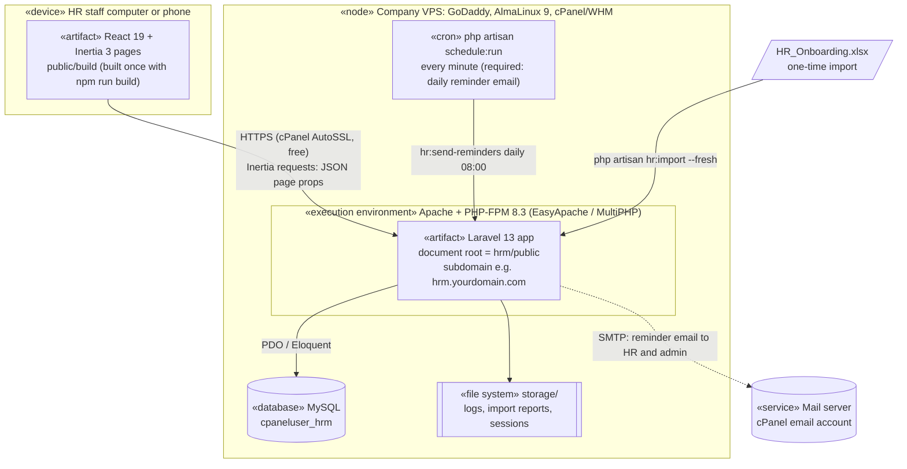
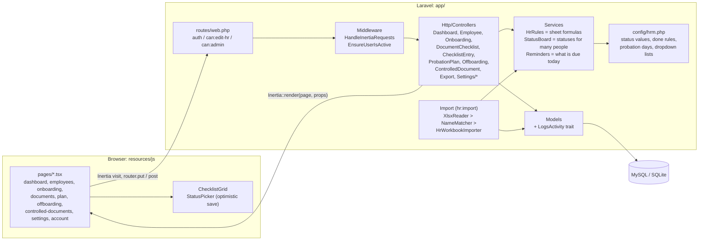
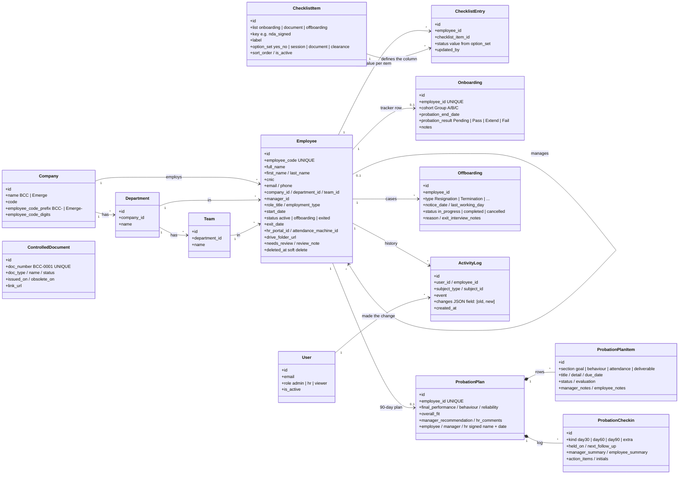
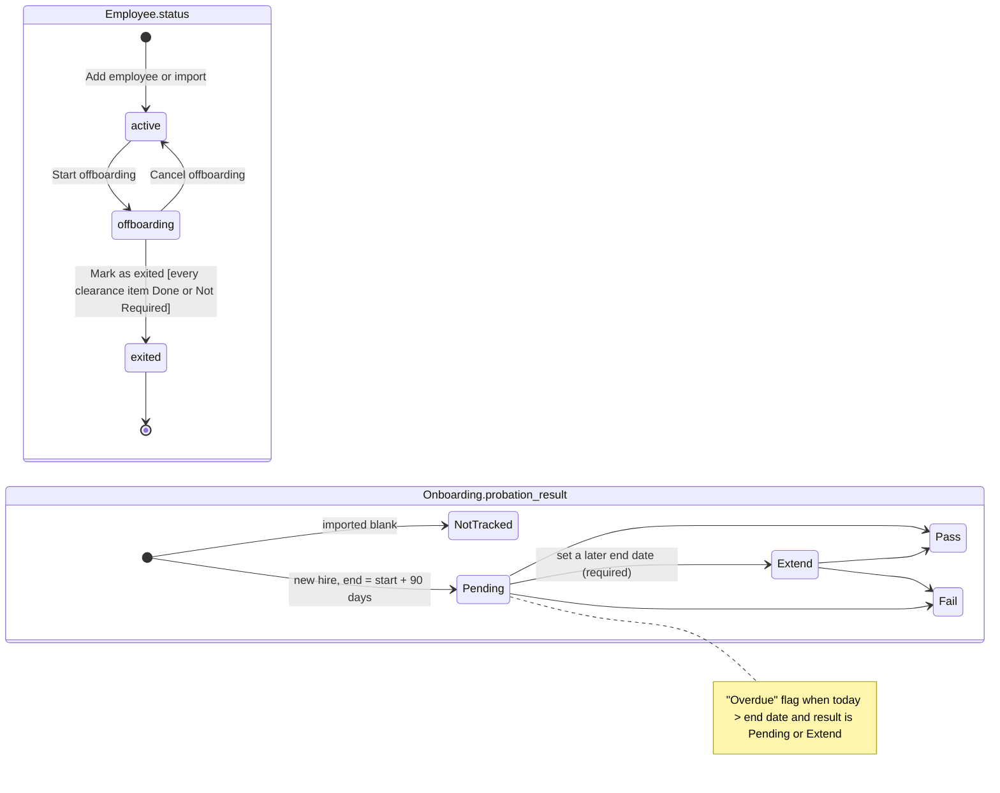
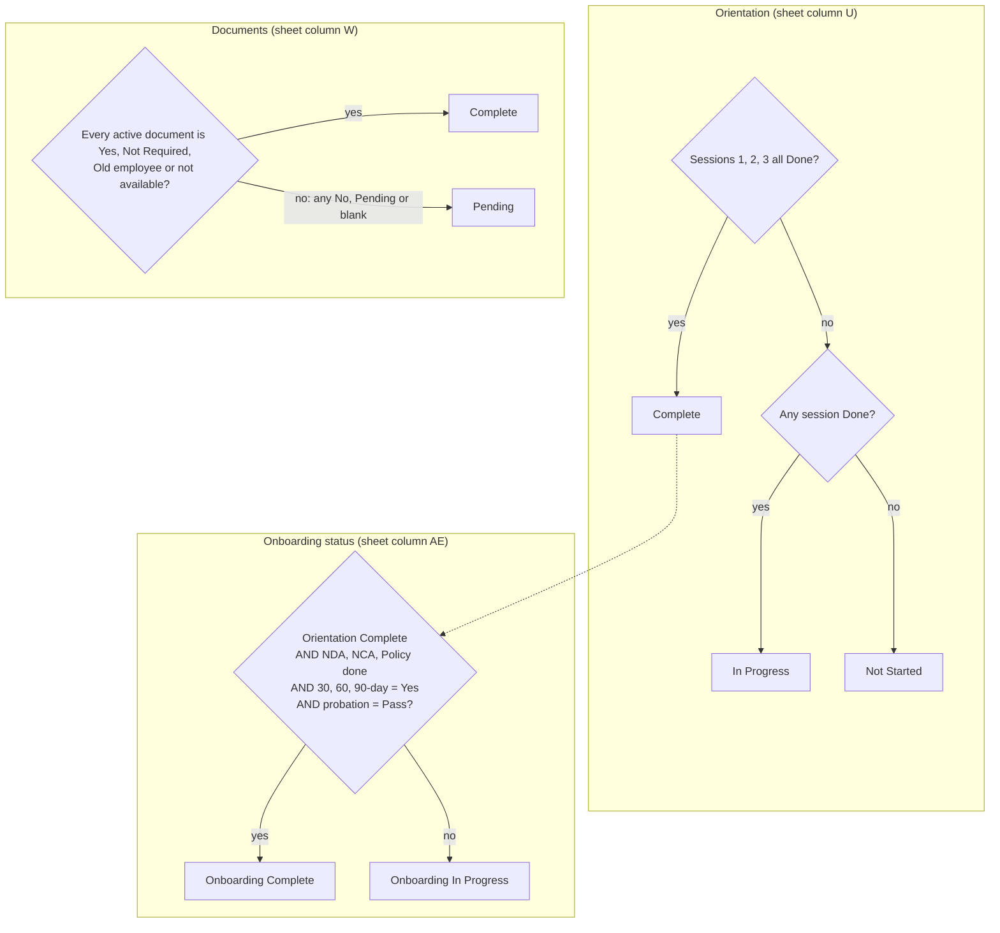
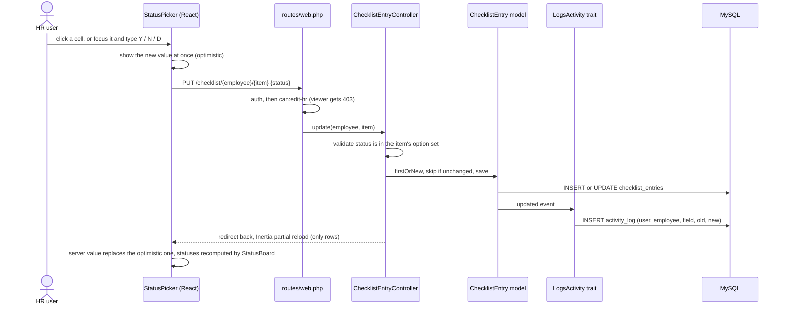
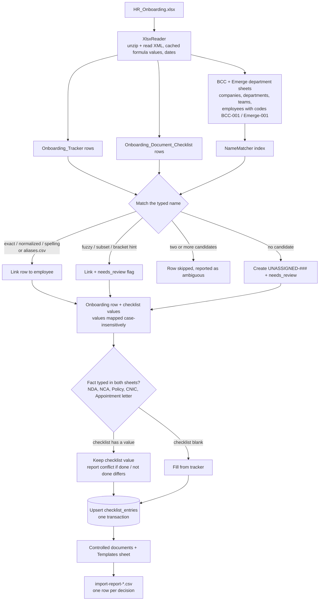

# HRM System: architecture

Every diagram below is Mermaid source (renders on GitHub, GitLab and in VS Code). A PNG and SVG of each sits next to its source in `docs/diagrams/`.

## 1. Deployment

One Laravel app on the existing cPanel VPS, next to the current Laravel app. Free components only: Apache and PHP-FPM from EasyApache, MySQL from cPanel, SSL from AutoSSL. Node is only needed on a developer machine to build the frontend; the server serves the built files from `public/build`. The `schedule:run` cron is required (no longer optional): it sends the daily reminder email, using the mail settings in `.env`.

## 2. Components

Requests flow left to right. Controllers never compute a status themselves: they call `HrRules` (single-person rules) or `StatusBoard` (the same rules for many people at once, one query). The values and rules live in `config/hrm.php`.

| Layer | Folder | What it does |
|---|---|---|
| Pages | `resources/js/pages` | One React file per screen. Props come from the controller's `Inertia::render()`. |
| Shared UI | `resources/js/components` | `ChecklistGrid`, `StatusPicker`, `StatusPill`, forms, shadcn/ui primitives. |
| Routes | `routes/web.php` | Every URL. Permissions are route middleware: `auth`, `can:edit-hr`, `can:admin`. |
| Controllers | `app/Http/Controllers` | Validate input, call rules, save models, return a page or redirect back. |
| Rules | `app/Services/HrRules.php`, `config/hrm.php` | The sheet's formulas as code. |
| Status board | `app/Services/StatusBoard.php` | Loads checklist values for many employees in one query and applies `HrRules`. |
| Reminders | `app/Services/Reminders.php`, `config/hrm.php` `reminders` | What HR has to act on today (probation, check-ins, documents, offboarding), computed live from `StatusBoard` and `HrRules`, never stored. Feeds the dashboard's "Needs attention" card and the daily email (`hr:send-reminders`, `app/Mail/RemindersDigest.php`). |
| Home and Overview | `DashboardController` (Home, `/dashboard`), `OverviewController` (`/overview`), `app/Services/HrSnapshot.php`, `app/Services/PeopleStats.php` | Home is what needs doing today; Overview is company-wide charts. Both read onboarding and document numbers from `HrSnapshot`, and headcount, joiners, leavers and turnover from `PeopleStats`. |
| Reports | `app/Services/Reports` (`ReportCatalog` lists them), `ReportController`, `resources/js/pages/reports` | Each report returns a `ReportResult` (columns, rows, summary, notes). The screen and the CSV download read the same result. Attendance reports go through `AttendanceBoard`, so they match the Attendance page. A new report is one catalog entry plus one method. |
| Models | `app/Models` | Eloquent models. `LogsActivity` writes every create, update and delete to `activity_log`. |
| Import | `app/Services/Import`, `app/Support/Xlsx` | `php artisan hr:import`: reads the workbook, matches names, writes data and a report. |

## 3. Data model

The fix for the spreadsheet's main problem: one `employees` row per person with a unique `employee_code`, and every other record points at `employees.id`. The sheet joined tabs on the typed name, which broke on every typo.

Why checklists are rows (`checklist_items` + `checklist_entries`) and not 30 columns:
- HR can add a document type or onboarding step in Settings, with no code change and no migration.
- One grid component serves onboarding, documents and offboarding clearance.
- Every single cell change is logged with who changed it, when, and the old and new value.

## 4. States

## 5. Computed statuses (the sheet's formulas)

Computed on every request from the checklist values, never stored, so they can't go stale. Source: `app/Services/HrRules.php`.

## 6. Sequence: HR changes one cell

## 7. Import pipeline (`php artisan hr:import`)

## Permissions

| Action | Viewer | HR | Admin |
|---|:-:|:-:|:-:|
| See dashboard, employees, grids, plans, offboarding, documents | yes | yes | yes |
| Export CSV | yes | yes | yes |
| Add or edit employees, change checklist values, bulk update | | yes | yes |
| 90-day plans, offboarding, controlled documents | | yes | yes |
| Delete an employee (soft delete) or a controlled document | | | yes |
| Users, departments and teams, checklist items | | | yes |

Enforced on the server by route middleware (`can:edit-hr`, `can:admin`, gates defined in `AppServiceProvider`). The React pages only hide buttons; a viewer calling the API directly gets 403 (covered by `tests/Feature/AccessTest.php`).

## Security notes

- No public sign-up. Admins create logins; switched-off users are logged out on their next request.
- Login is rate limited (5 tries per minute per email and IP).
- Employees are soft-deleted and every change is in `activity_log`.
- `public/` is the only web-visible folder. The `local` disk does not serve files over HTTP. Import reports (they contain names) stay in `storage/app/private/import`.
- Inertia DevTools recording is switched off in `.env` (`INERTIA_DEVTOOLS_ENABLED=false`) so request data is never written to disk, even if `APP_ENV` is left on `local` by mistake.
- Strict Eloquent mode is on outside production (no lazy loading, no silent attribute typos).
