# HRM System: architecture

_For developers joining the project. Last rewritten 2026-10-23 against `main`. Every diagram is Mermaid source (renders on GitHub and in VS Code). The ERDs in section 5 were generated from the migrated schema, not drawn by hand._

**Keep this file true.** A new table, a new subsystem, a new external service or a change to who can do what updates the matching section here in the same commit. `CLAUDE.md` sends every developer and AI agent here first.

## 0. The system in one paragraph

An internal HR app for two companies, BCC and Emerge (about 280 people). HR keeps the employee master, onboarding and document checklists, probation, offboarding, leave, attendance (from a ZKTeco fingerprint machine, the HR.my portal and an in-app clock-in), staff requests (WFH, attendance fixes, loans, medical), performance reviews, letters, assets and controlled documents. Staff get a self-service "My page". One Laravel monolith serves server-rendered React pages through Inertia: there is no separate API and no SPA backend.

| | |
|---|---|
| Backend | Laravel 13, PHP 8.3 |
| Frontend | React 19 + TypeScript, Inertia 3, Tailwind 4, shadcn/ui, Vite 8 |
| Database | PostgreSQL (Neon) in production; SQLite locally and in tests; the suite also runs on Postgres |
| Hosting | Render (Docker, free plan), Cloudflare R2 for files, Resend for email, cron-job.org for timed jobs |
| Size | 46 app tables, ~56 models, ~48 controllers, ~50 pages, ~380 feature tests |

```
hrm-system/
  app/Http/Controllers      one controller per area; Settings/* is admin-only
  app/Models                Eloquent models; Concerns/LogsActivity writes the audit log
  app/Services              the rules: HrRules, StatusBoard, AttendanceBoard, AttendanceRules, LeaveBalances, Reports/*, Import/*
  app/Support               file readers (Xls, Xlsx), ZK machine client, CSV writer
  app/Console/Commands      hr:* artisan commands
  config/hrm.php            every HR value, status list, option set and switch
  routes/web.php            every URL and its permission group
  resources/js/pages        one React page per screen (Inertia::render('x/y') -> pages/x/y.tsx)
  resources/js/components   shared UI; ui/ is shadcn
  tests/Feature             behaviour tests; RouteAccessTest walks every route
  docs/                     this file, deploy guides, reviews
```

## 1. Deployment

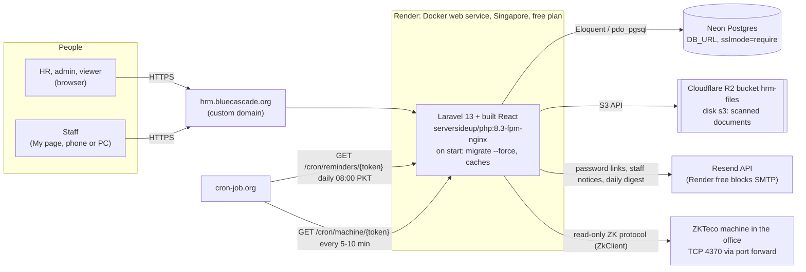

- **Build** (`Dockerfile`, three stages): `node:22-slim` runs `npm run build` into `public/build`; `composer:2` installs PHP packages without dev; the runtime image adds `intl`, `pdo_pgsql`, `gd`. Port 8080, upload limit 12 MB. Health check `/up`.
- **On every start** serversideup's automations run `migrate --force`, `storage:link` and the config/route/view caches. A data fix that must reach live goes in a migration (example: `2026_10_23_000400_set_hr_logins_home_company.php`), written through models so it is logged, and only filling what is empty.
- **Deploy** = `git push` to `main` on GitHub; Render auto-deploys. Changes to `render.yaml` env vars need a Blueprint sync. Secrets (`APP_KEY`, `DB_URL`, R2 keys, `RESEND_API_KEY`, `ZK_*`, `CRON_TOKEN`) live only in Render's environment, never in the repo.
- **Free plan facts**: the instance sleeps after 15 idle minutes (first request is slow) and its disk is wiped on restart, so nothing durable may be written to local disk in production: files go to R2, sessions and cache to the database.
- **No scheduler process.** `routes/console.php` schedules `hr:send-reminders`, but Render runs no `schedule:run`; cron-job.org calls `CronController` URLs instead (token compared with `hash_equals`, 404 when wrong, `throttle:10,1`).
- **Queue** is `sync` in production and tests: nothing implements `ShouldQueue`, mail is sent inside the request. A mail failure is `report()`ed and the action still saves.
- **Local**: SQLite `database/database.sqlite`, `php artisan serve`, `npm run dev` or `npm run build`. The machine needs PHP 8.3. `docs/DEPLOY-cPanel.md` describes the older VPS host and is not in use.

## 2. How a request flows

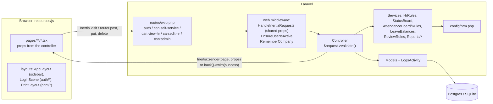

| Layer | Where | Rule |
|---|---|---|
| Routes | `routes/web.php` | Every write route sits in a permission group. `RouteAccessTest` fails if one doesn't. |
| Controllers | `app/Http/Controllers` | Validate, call a service for anything computed, save through models, return a page or `back()` with a flash message. |
| Rules | `app/Services/*`, `config/hrm.php` | Status logic lives in one place. Controllers and React never compute onboarding, document, probation or attendance status themselves. |
| Models | `app/Models` | Strict mode outside production: eager-load (`with()`), no lazy loading, no unknown attributes. New columns with defaults also need the default in `$attributes`. |
| Shared props | `HandleInertiaRequests` | `auth.user`, `auth.can.{edit,admin,view,self}`, `flash`, `nav` (sidebar badges, HR only), `me.todo` (staff). |
| Pages | `resources/js/pages` | Props shape mirrors the controller; shared types in `resources/js/types/index.ts`. Dates arrive as `Y-m-d`, timestamps as ISO 8601. |

## 3. Who can do what

| Role (`users.role`) | Gets |
|---|---|
| `employee` | My page only, for the employee record linked by `users.employee_id`. |
| `viewer` | Every HR page read-only. Private fields arrive as `null`. |
| `hr` | Everything a viewer sees, plus all edits, approvals, files, letters, reviews, staff logins. |
| `admin` | Everything, plus deletes and Settings (users of every role, structure, checklists, test email). |

- **Gates** (`AppServiceProvider`): `view-hr` (admin, hr, viewer), `edit-hr` (admin, hr), `admin`, `self-service` (a login linked to an employee). Route groups use them as `can:` middleware; hiding a button in React is never the check.
- **My page** (`MeController`) only ever reads `$request->user()->employee_id`, never an id from the URL.
- **Private fields**: `Employee::PRIVATE_FIELDS` (CNIC, date of birth, addresses, emergency contact, bank details) are sent as `null` unless `can('edit-hr')`, and logged as `hidden` in the activity log. Loans, medical requests, meetings, conduct entries and the machine comm key have their own `PRIVATE_FIELDS`. Exports follow the same rule (the employees CSV drops CNIC for viewers).
- **Logins**: no public sign-up. Admins manage every login in Settings > Users; HR creates **staff** logins only (`StaffLoginsController`, `/logins`), and gets 403 on any other role. The person sets their own password from an emailed link (password broker `invites`, 3 days; resets use `users`, 60 minutes). `EnsureUserIsActive` logs out switched-off logins; making an employee `exited` switches their login off (`Employee::booted`).
- **Companies**: `users.company_id` is a login's home company. `RememberCompany` remembers the All / BCC / Emerge choice per login on the pages in its `PAGES` list and opens them on the home company. It narrows what is shown; it is not a restriction.
- **Tests that hold this in place**: `RouteAccessTest` (every write route gated; employee logins get 403 everywhere outside My page; viewers 403 on edit routes; HR 403 on admin routes), `AccessTest`, `SecurityRegressionTest`, `StaffLoginsTest`, `CompanySwitchTest`.
- **Why no row-level security**: only the Laravel app connects to the database, with one credential. Access control is in the app layer above. Anything that ever connects to the database directly (a BI tool, a second service) changes this.

## 4. Data model

46 app tables plus Laravel's own (`users` is shared, `sessions`, `cache`, `jobs`, `password_reset_tokens`, `migrations`). Conventions:

- **Everything links to `employees.id`.** Never join or look up by name; names are matched only by the importers.
- **Who did it**: most tables carry `created_by`, `updated_by`, `decided_by`, `requested_by` etc. pointing at `users`. They are left out of the diagrams below. `User::HISTORY_COLUMNS` must list every one of them (a test checks).
- **Soft deletes** on employees; a deleted employee is archived, not removed.
- **Audit**: every model with `LogsActivity` writes created / updated (`{field: [old, new]}`) / deleted to `activity_log`.
- **Settings** that HR can change at runtime (probation days, leave weights) live in `app_settings` as key/value rows; everything else is in `config/hrm.php`.
- **Checklist items are data**: a new document type or onboarding step is a row in `checklist_items`, not a migration. Keys in `HrRules::REQUIRED_KEYS` must never be removed.

### 4.1 People and organisation

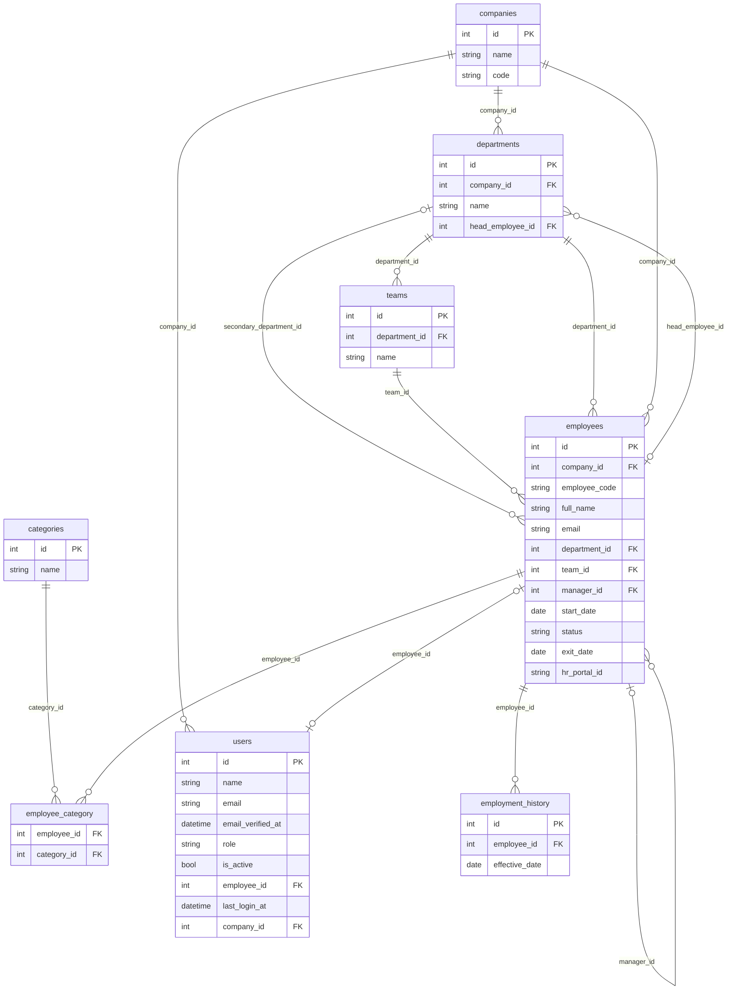

`employees` has 55 columns: identity and contact, job (company, department, team, role, manager, secondary manager and department, employment type, work mode), the private fields, attendance links (`attendance_machine_id`, `hr_portal_id`, `attendance_device_id`), status (`active`, `review`, `offboarding`, `exited`) and import provenance (`legacy`, `source_ref`). Job changes write `employment_history` automatically (`JobHistory::record`).

### 4.2 Attendance

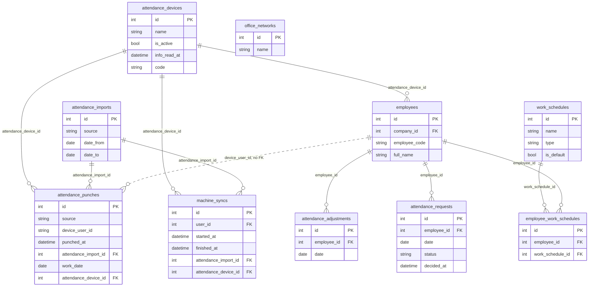

`attendance_punches` has **no foreign key to employees**. A punch is `(source, device_user_id, punched_at)`, unique, and is matched to a person when the day is computed: `machine` punches by `employees.attendance_machine_id`, `hrmy` by `employees.hr_portal_id`, `app` by `employees.id`. Linking a number to a person (Attendance > Links) therefore re-attributes all of that number's past punches at once.

### 4.3 Leave and holidays

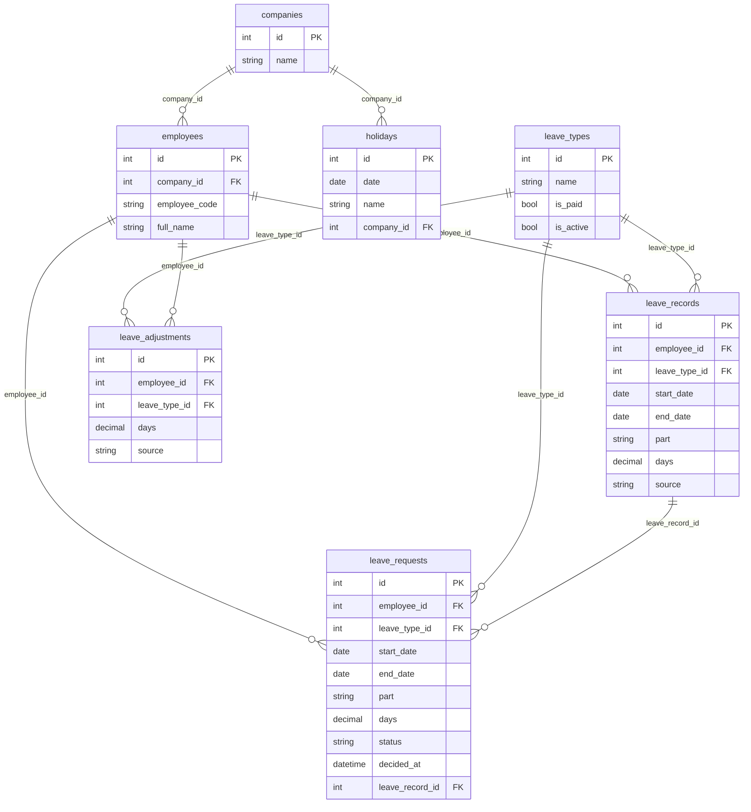

### 4.4 Staff requests

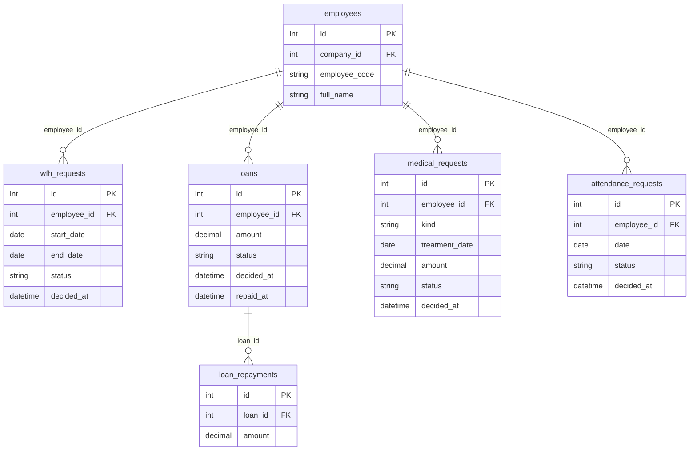

### 4.5 Onboarding, documents, probation, offboarding

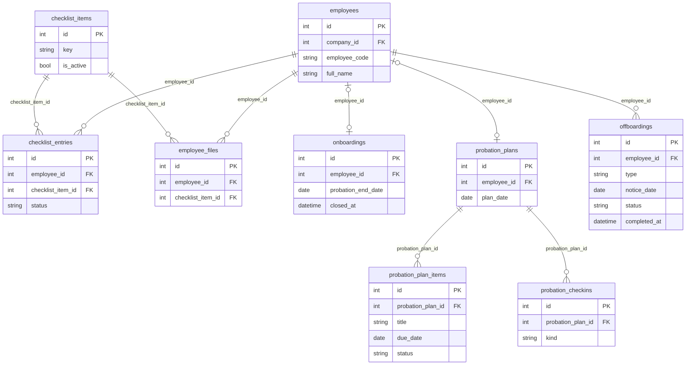

### 4.6 Reviews and feedback

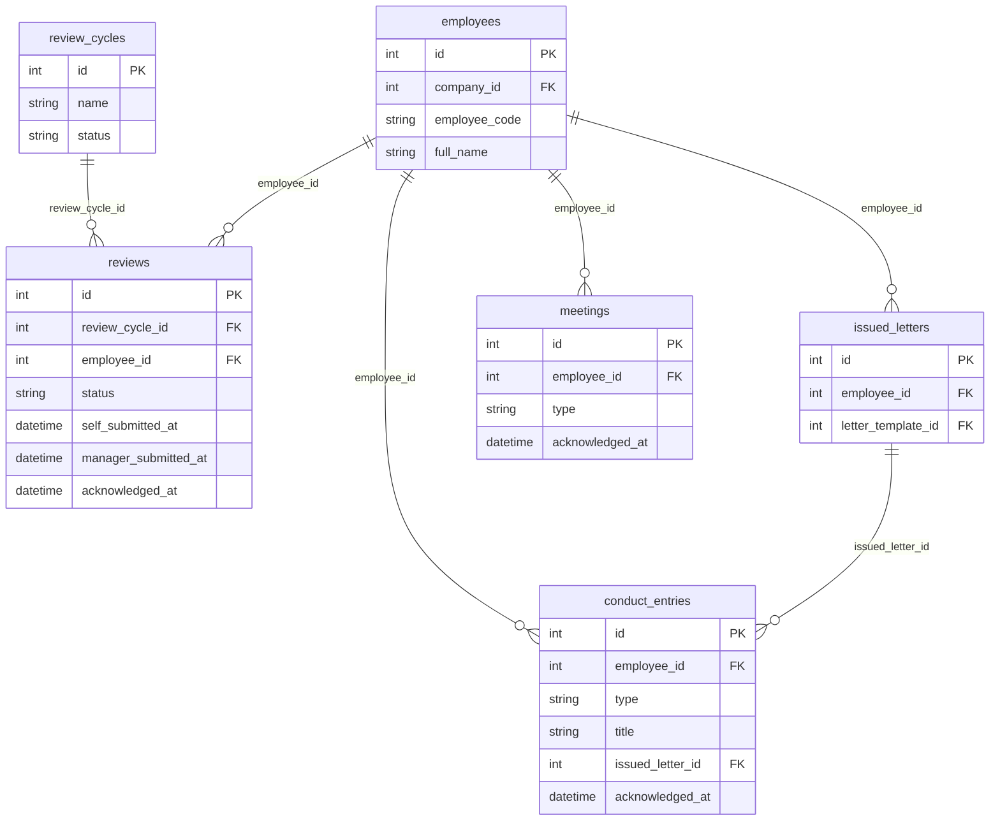

### 4.7 Letters, assets, controlled documents

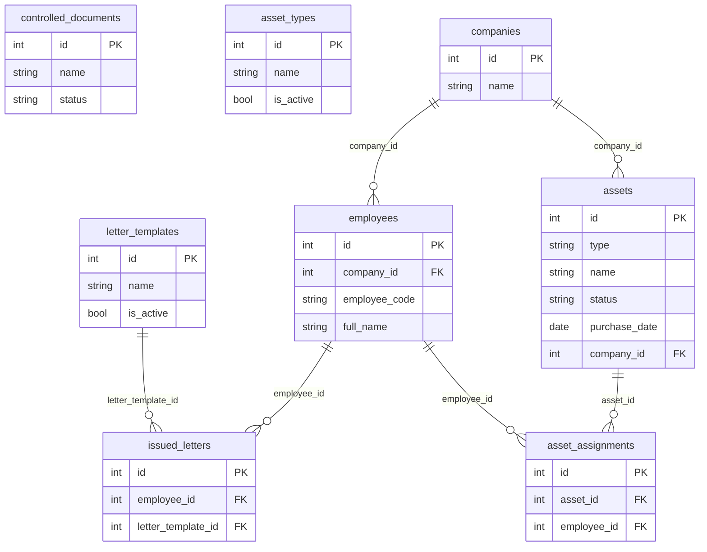

### 4.8 Logins and audit

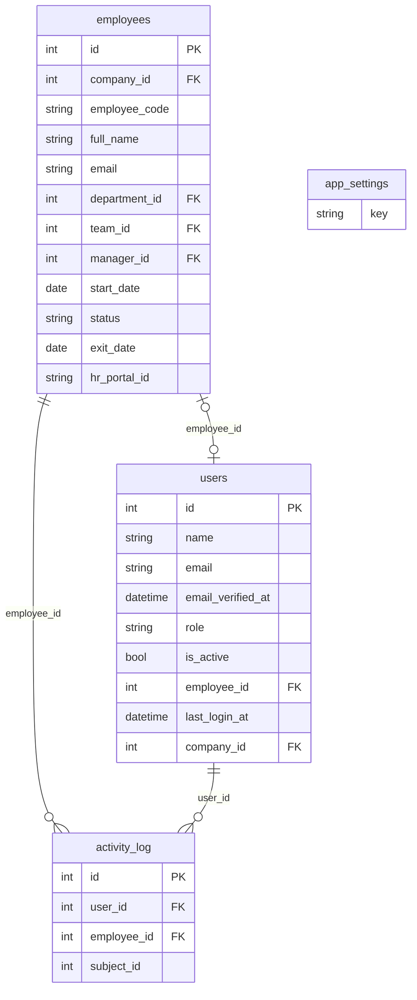

## 5. Attendance

The most involved subsystem. Three sources write punches; one engine turns punches into a status per person per day; every screen and report reads that engine.

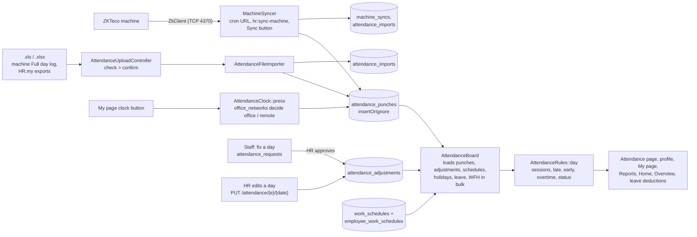

- **Work date**: remote punches (HR.my, app) before `hrm.attendance.day_starts_at` (03:00) belong to the previous day; an app check-out takes its check-in's date. Machine punches keep their calendar date. Times after midnight show past 24:00 on the board ("25:30") and as "01:30 (24 Oct)" in the sign-in sheet.
- **Sessions**: machine punches in a row form one block (first to last); HR.my and app punches pair In/Out. Double taps within 5 minutes are one punch. A session wholly inside another adds no time.
- **Schedule**: the latest `employee_work_schedules` row on or before the date, else the `is_default` schedule. Fixed schedules give late (after start + grace), left early, half day, absent after the cut-off and overtime; flexible schedules give "short". Missing check-out is either filled with the end time (`missing_checkout = auto`) or flagged.
- **Statuses** and their colours are in `config/hrm.php` `attendance.statuses` (Present, Late, Half day, Absent, Missing punch, On leave, Holiday, Day off, Worked day off, At work, Not in yet, Not linked, No data ...). "No data" means no punches from that source at all that day, so absence would be a guess.
- **HR corrections** never edit punches: `attendance_adjustments` (one per person per day) override check-in/out or the sessions, or mark a weekly day off, always with a note.
- **Machine sync** takes a cache lock per device, reads back `lookback_days` before the newest stored punch, records every attempt in `machine_syncs` (pruned after 30 days) and flags overdue devices in the daily digest.

## 6. Workflows

Every staff request follows the same pattern: the person creates it on My page (`can:self-service`) and may cancel while `pending`; HR approves or rejects (`can:edit-hr`, a reject needs a note); the decision emails the person through `StaffMail` (`StaffNotice`, sent from their company's HR address, linking back to `/me#section`). `RequestsInboxController::QUEUES` gathers the five queues on `/requests` and feeds the sidebar badges.

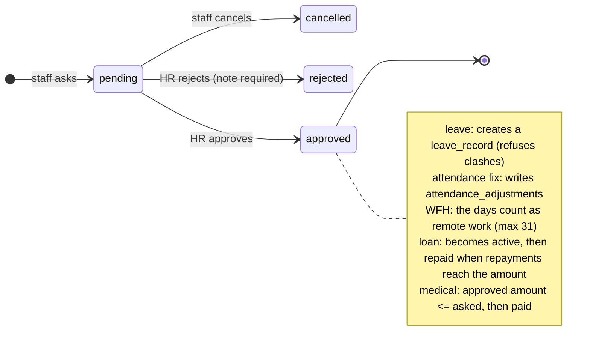

| Area | Controllers | Tables | Notes |
|---|---|---|---|
| Onboarding | `OnboardingController`, `ChecklistEntryController`, `DocumentChecklistController` | `onboardings`, `checklist_items`, `checklist_entries` | Grid cells save one at a time (optimistic). Statuses are computed by `HrRules` / `StatusBoard` (section 7). Closing removes a record from the tracker and reminders. |
| Probation | `ProbationPlanController` | `probation_plans`, `probation_plan_items`, `probation_checkins` | End = start + `probation_days` (`app_settings`). The 90-day plan is behind `HRM_PROBATION_PLAN`. Extend needs a later end date. |
| Files | `EmployeeFileController` | `employee_files` | PDF/JPG/PNG up to 10 MB on `hrm.uploads.disk` (R2 in production) under `employee-files/{id}/`. Served only through the app, HR and admin only. `HRM_FILES_ENABLED` switches uploads off. |
| Offboarding | `OffboardingController` | `offboardings` | Complete needs every clearance item done and no assets still out; sets `exited`, which switches the login off. Cancel returns the person to active. |
| Leave | `MeController`, `LeaveRequestController`, `LeaveController` | `leave_types`, `leave_records`, `leave_requests`, `leave_adjustments`, `holidays` | Balances in `LeaveBalances`: pro-rated allowance, records + adjustments used, plus deductions from attendance (absences, late/early) taken from Casual then Annual. Holidays are per company or common (`company_id` null). |
| Requests | `AttendanceRequestController`, `WfhRequestController`, `LoanController`, `MedicalRequestController`, `RequestsInboxController` | see 4.4 | The pattern above. |
| Reviews | `ReviewController`, `MeController`, `FeedbackController` | `review_cycles`, `reviews`, `conduct_entries`, `meetings` | Cycle draft > open > closed; review self_review > manager_review > completed. HR and admin only, even for reading. Staff acknowledge reviews, warnings and shared meeting notes on My page. |
| Letters | `LetterController` | `letter_templates`, `issued_letters` | `LetterRenderer` fills 14 `{{fields}}`; reference `CODE/HR/YYYY/NNN`. Issuing can also create a conduct entry and tick an offboarding item. Print view `print/letter`. |
| Assets | `AssetController` | `assets`, `asset_types`, `asset_assignments` | An asset is with someone while its assignment has no `returned_on`. Status changes only through give / take back. |
| Controlled documents | `ControlledDocumentController` | `controlled_documents` | Numbered `BCC-0001`; Draft, Active, Obsolete. |
| Staff logins | `StaffLoginsController`, `Settings\UserController`, `Settings\StaffLoginController` | `users` | See section 3. |

## 7. Onboarding rules and the HR workbook import

_Unchanged since the first version of this document; still how the code works._

### 7.1 Onboarding and probation states

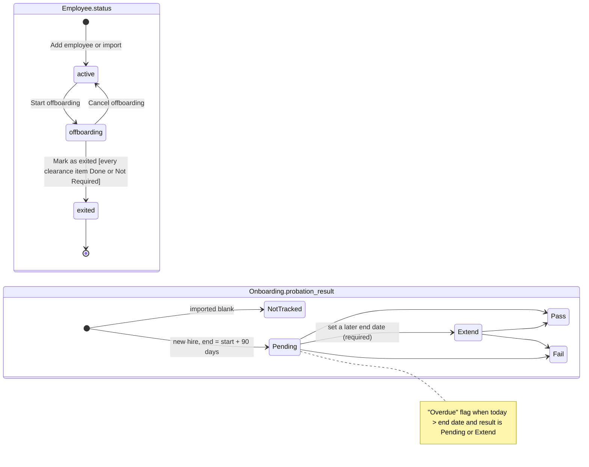

### 7.2 Computed statuses (the sheet's formulas)

Computed on every request from the checklist values, never stored, so they can't go stale. Source: `app/Services/HrRules.php`.

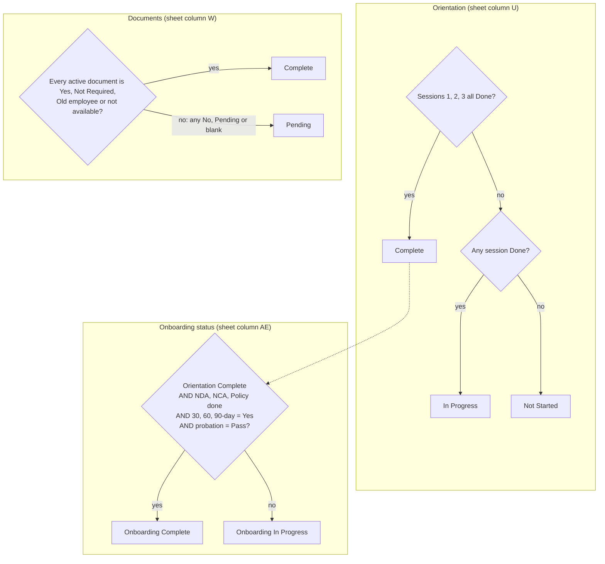

### 7.3 Sequence: HR changes one cell


### 7.4 Import pipeline (`php artisan hr:import`)

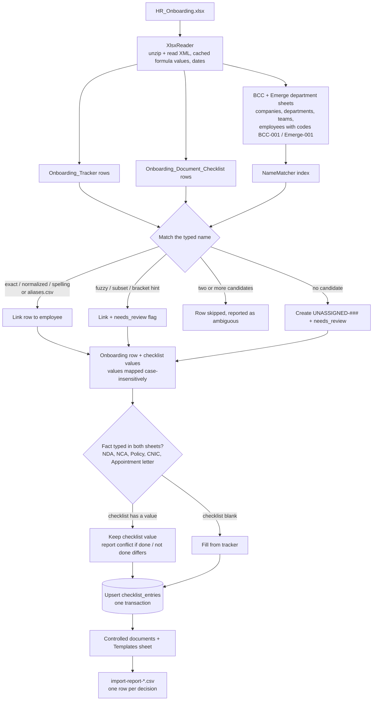

## 8. Timed jobs and email

| What | Trigger | Code |
|---|---|---|
| Daily digest to HR and admin (what is due: probation, check-ins, documents, offboarding, overdue machine) | cron-job.org `GET /cron/reminders/{token}` once a day (guarded by `Cache::add`) | `hr:send-reminders`, `app/Services/Reminders.php`, `app/Mail/RemindersDigest.php`. One digest per home company; an empty digest sends nothing. Sent from the default sender. |
| Machine sync | cron-job.org `GET /cron/machine/{token}` every 5-10 minutes | `MachineSyncer::runAll` (devices with `auto_sync`) |
| Staff notices (decisions, letters, warnings) | inline, in the request | `StaffMail` → `StaffNotice`, from `Company::mailFromFor` (`companies.hr_email`, else the default sender) |
| Password and welcome links | inline | `SetPasswordNotification`; the link uses the host the sender is browsing on (`url()`), so send from `hrm.bluecascade.org` |

Artisan commands (`app/Console/Commands`): `hr:import` (one-time seed from the HR workbook), `hr:copy-data` (copy a whole database to another connection; used once to move to Neon), `hr:create-admin`, `hr:send-reminders --dry-run`, `hr:sync-machine {device?}`, `hr:redate-punches --apply`.

## 9. Reports, imports and exports

- **Reports** (`app/Services/Reports`): `ReportCatalog` lists them, each a method returning a `ReportResult` (columns, rows, summary, notes). The screen and "Download for Excel" read the same result, so they never disagree. Filters: month, range, year, date, day, week, company, department, team, category, manager. A new report is one catalog entry and one method. Attendance reports go through `AttendanceBoard`. Private reports (`'private' => true`) are HR and admin only.
- **CSV exports** (`ExportController`): employees, onboarding, documents, with the list's current filters. CNIC only for HR and admin.
- **Spreadsheet imports** (`SpreadsheetImportController::KINDS`: details, assets, links, leave-sheet): download a template, upload, preview the plan, apply (the plan is recomputed before saving) or discard. HR only.
- **Attendance files** are covered in section 5. **The HR workbook seed** is section 7.

## 10. Frontend

- `resources/js/app.tsx` resolves pages with `import.meta.glob('./pages/**/*.tsx')` and picks the layout by name: `auth/*` → `LoginScene`, `print/*` → `PrintLayout`, the rest → `AppLayout` (sidebar from `components/app-sidebar.tsx`).
- Shared building blocks: `ChecklistGrid` and `StatusPicker` (the onboarding and document grids), `StatusPill` (word plus colour, never colour alone), `CompanySwitch`, `FilterBar`, `EmployeeSearch`, `ClockCard`, `DecideDialog`, `FlashToaster`; shadcn primitives in `components/ui`.
- Design tokens are in `resources/css/app.css` `@theme`: brand navy `#00435C` for actions, colour only for status, every text pair at 4.5:1. Fonts: Atkinson Hyperlegible Next (body, numbers), Jost (titles).
- UI copy: sentence case, plain words HR staff use, buttons say what they do ("Save plan", not "Submit").

## 11. Working on it

| To add | Do |
|---|---|
| A page | Controller method + route in the right permission group + `resources/js/pages/<area>/<name>.tsx`; keep `types/index.ts` in step. |
| A write route | Inside a `can:edit-hr`, `can:admin` or `can:self-service` group, with `$request->validate()`. `RouteAccessTest` enforces it. |
| A table | Migration, model with `LogsActivity`, defaults mirrored in `$attributes`, any `*_by` column added to `User::HISTORY_COLUMNS`, and a section 4 ERD update. |
| A status or option | `config/hrm.php`; the formula in `HrRules` / `AttendanceRules`, never in a controller or React. |
| A checklist item | A row in Settings > Checklists (or `ChecklistItemSeeder` for defaults), not a migration. |
| A report | `ReportCatalog` entry + method in `app/Services/Reports`. |
| A data fix on live | A migration through models (logged), filling only what is empty. |

**Definition of done**: `php vendor/bin/phpunit` passes (also `-c phpunit.pgsql.xml` against a local Postgres for anything database-specific), `npx tsc --noEmit` is clean, `npm run build` works, and the changed screen has been opened in a browser at desktop and phone width. **No real HR data** in the repo, tests, fixtures, screenshots or logs: tests build fake workbooks with `tests/Support/XlsxBuilder.php`.

## 12. Security notes

- HTTPS only, secure session cookies, `APP_DEBUG=false` in production, sessions in the database.
- Login rate limit: 5 tries per minute per email and IP. Password links expire (3 days for invites, 60 minutes for resets).
- Employees are soft-deleted; every change is in `activity_log` with private values masked.
- Files: private disk or R2 bucket, never public URLs; served by `EmployeeFileController` after the permission check.
- Strict Eloquent outside production; Inertia DevTools recording off.
- Open items (owner's list, 2026-10-23): rotate the Neon password, keep an offline copy of `APP_KEY`, replace the admin login copied from the local machine, two-step login for admin and HR, encrypting CNIC and bank account columns, own database backups beyond Neon's short restore window.
